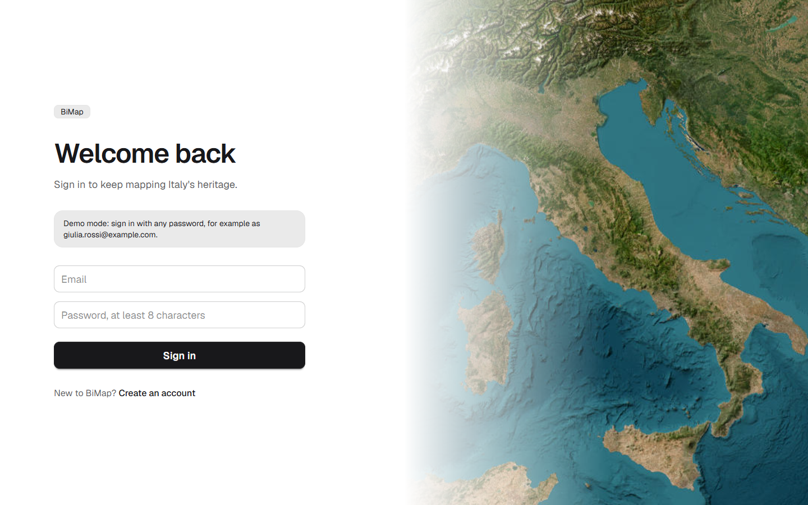
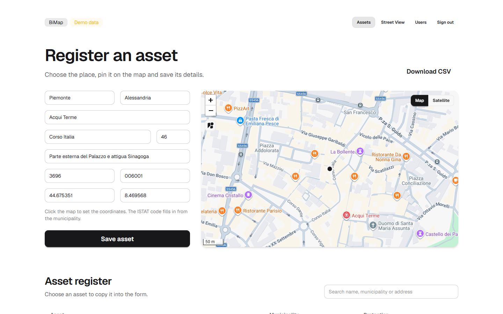
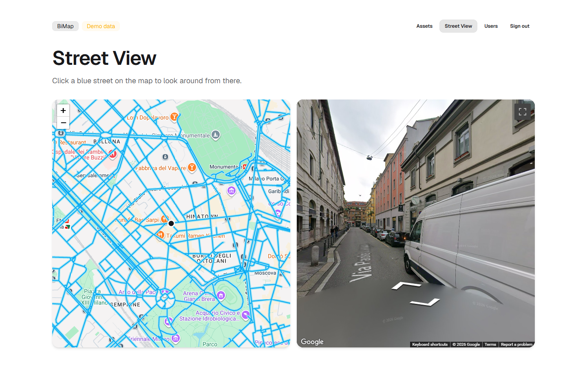
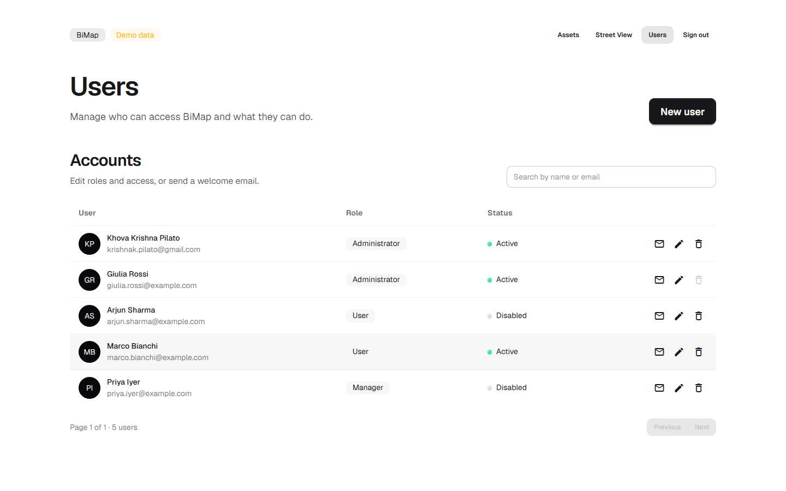
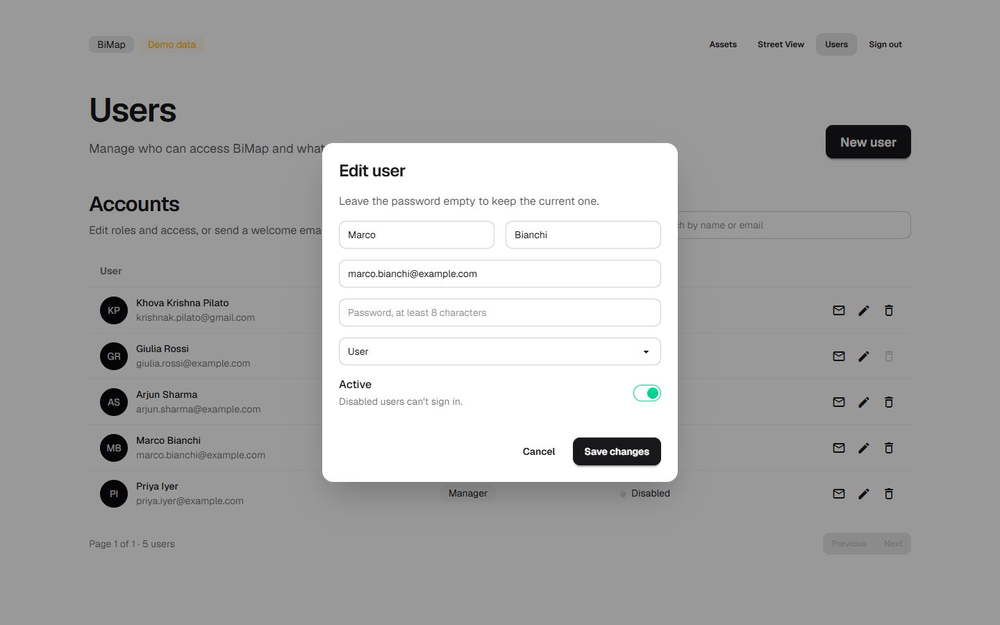
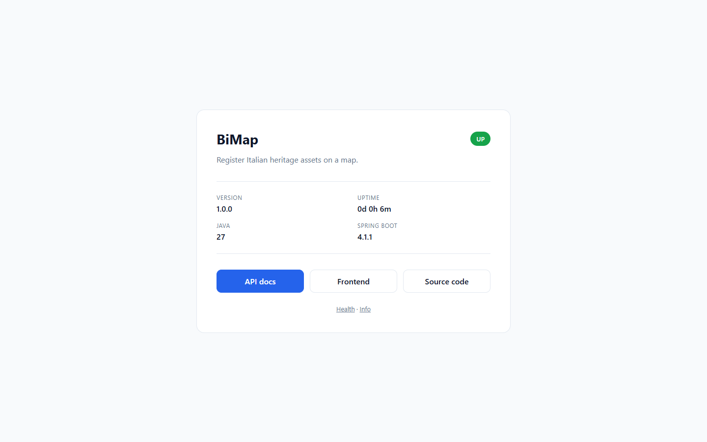
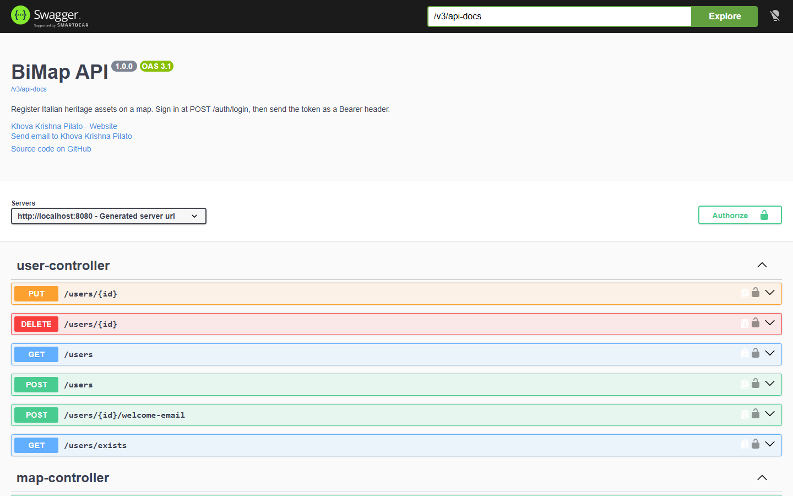

# BiMap

A web application for registering Italian heritage assets on a map: pick a place, check it in Street View, save its details. Administrators manage who can use it.


**Live demo:** [krishnapilato.github.io/bimap](https://krishnapilato.github.io/bimap/) — runs entirely in the browser with mock data, no sign-in needed.

---

## Screenshots

### Frontend

| Landing page | Sign in |
|---|---|
|  |  |

| Register an asset | Street View |
|---|---|
|  |  |

| Users | Edit a user |
|---|---|
|  |  |

### Backend

| Landing page | API documentation |
|---|---|
|  |  |

## Architecture

```
Browser ──▶ Angular frontend (port 4200) ──▶ Spring Boot API (port 8080) ──▶ MySQL
                │                                  │
                │                                  └──▶ SMTP server (emails)
                ├──▶ Comuni-ITA API (regions, provinces, municipalities, ISTAT codes)
                ├──▶ Nominatim (address lookup)
                └──▶ Google Maps (tiles and Street View)
```

- **Frontend** — Angular 22 single-page app styled with Tailwind CSS and daisyUI, with a Leaflet map and Google Street View.
- **Backend** — stateless REST API secured with JWT, documented with OpenAPI.
- **Database** — MySQL, holding users, saved forms and the asset register.

## Repository

| Folder | What is in it |
|---|---|
| [`backend/`](backend/README.md) | The REST API, security and Docker setup. |
| [`frontend/`](frontend/README.md) | The Angular client, including the demo build for GitHub Pages. |

## Getting started

### 1. Backend and database (Docker)

```bash
cd backend
cp .env.example .env
docker compose up -d --build
```

Fill in `.env` first. The API then runs on <http://localhost:8080>, with interactive documentation at <http://localhost:8080/swagger-ui.html>. See the [backend README](backend/README.md) for configuration, the API reference and running without Docker.

### 2. Frontend

Requires Node.js and npm.

```bash
cd frontend
npm install
npm start
```

Open <http://localhost:4200>. The frontend talks to the API at `http://localhost:8080`, set in `frontend/src/environments/`.

With the `dev` profile enabled in `.env`, the backend creates demo accounts with the password `12345678`, for example `giulia.rossi@example.com` (administrator) and `marco.bianchi@example.com` (user).

To try the frontend without any backend, run `npm run start:demo` instead.

## Deployment

Every push to `main` builds the demo and publishes it to GitHub Pages through [`.github/workflows/pages.yml`](.github/workflows/pages.yml).

## Author

**Khova Krishna Pilato** — [github.com/krishnapilato](https://github.com/krishnapilato)
