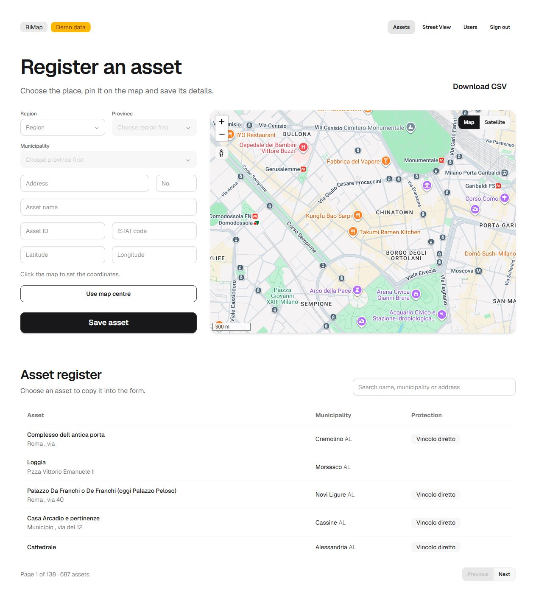
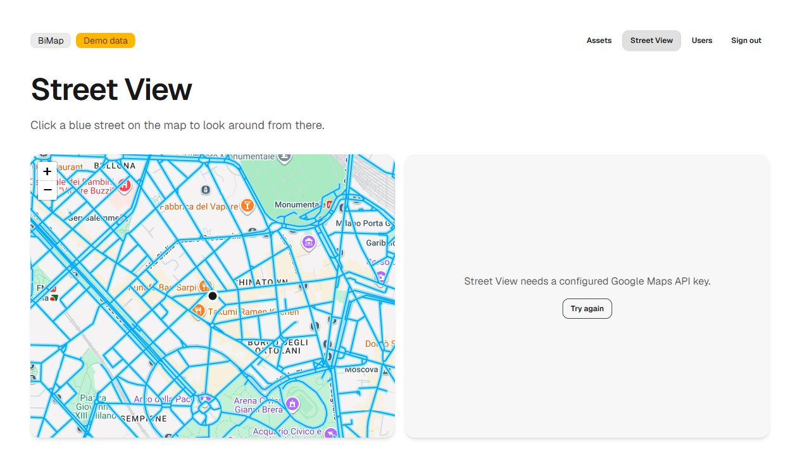
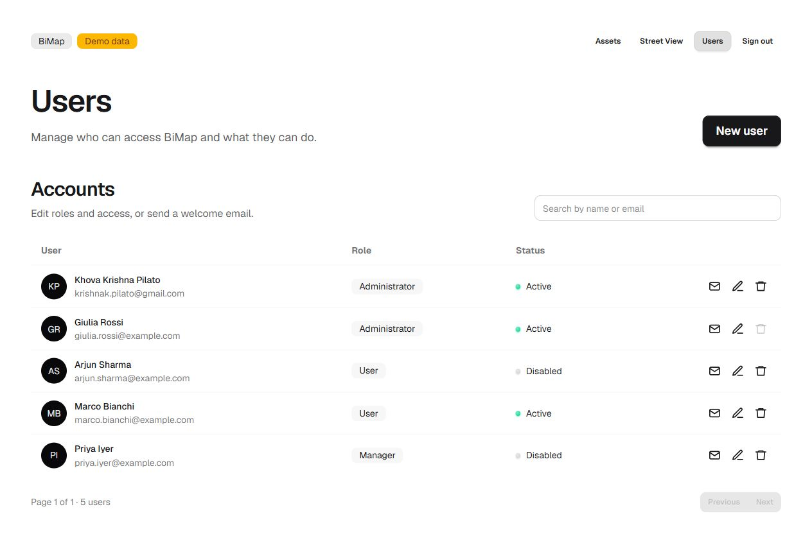
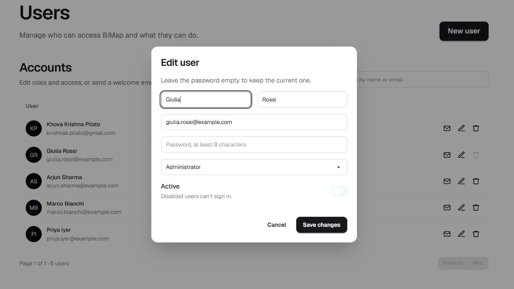
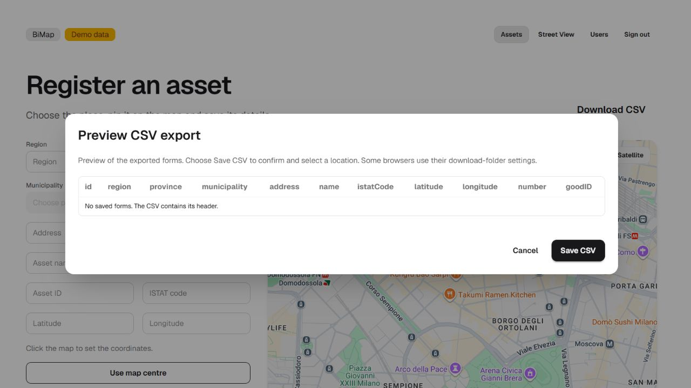
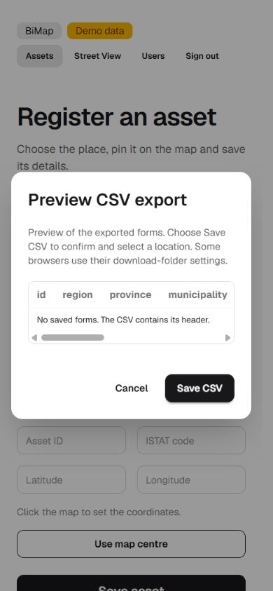
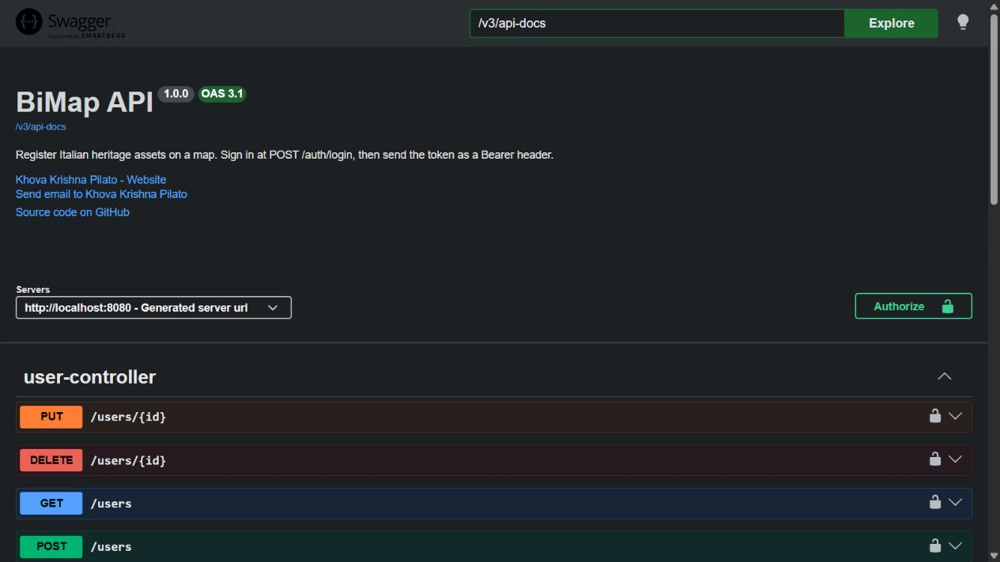

# BiMap

A web application for registering Italian heritage assets on a map: pick a place, check it in Street View, save its details. Administrators manage who can use it.

[](https://github.com/krishnapilato/bimap/actions/workflows/ci.yml)
[](LICENSE)

**Live demo:** [krishnapilato.github.io/bimap](https://krishnapilato.github.io/bimap/) — runs entirely in the browser with mock data, no sign-in needed.

---

## Screenshots

### Frontend

| Landing page | Sign in |
|---|---|
|  |  |

| Register an asset | Street View (local build without a Maps key) |
|---|---|
|  |  |

| Users | Edit a user |
|---|---|
|  |  |

| CSV preview | CSV on mobile |
|---|---|
|  |  |

### Backend

| Landing page | API documentation |
|---|---|
|  |  |


## Quality

Compiler warnings and static-analysis violations fail the build: unused code, lint findings and compiler warnings do not pass, locally or in [CI](.github/workflows/ci.yml).

| Check | Backend | Frontend |
|---|---|---|
| Compiler | `javac -Xlint:all -Werror` | TypeScript `strict`, `noUnusedLocals`, `noUnusedParameters` |
| Static analysis | [PMD 7](backend/pmd-ruleset.xml): unused code, bug patterns, clean-code rules | [ESLint](frontend/eslint.config.mjs): `typescript-eslint` strict type-checked, `angular-eslint`, SonarJS |
| Templates | — | Angular strict templates, extended diagnostics as errors |
| Tests | JUnit 6, MockMvc and Mockito against real SQLite, with concurrent account/rate-limit checks and migration/backup coverage (75 tests) | Vitest (39 tests) |
| Security headers | Strict Content Security Policy, `frame-ancestors 'none'`, `no-referrer` | Content Security Policy with hashed scripts (`autoCsp`) |
| Docker | Both images built in CI | Both images built in CI |
| Dependencies | Dependabot, weekly | Dependabot, weekly; `npm audit` clean |

### Lighthouse

Historical baseline from before the gallery and UI refresh, measured with Lighthouse 13. These scores have not been remeasured for the current UI. Mobile uses Lighthouse's simulated slow 4G and a 4× slower CPU.

| Page | Performance (mobile / desktop) | Accessibility | Best practices | SEO |
|---|:-:|:-:|:-:|:-:|
| Landing page | 88 / 100 | 100 | 100 | 100 |
| Sign in | 85 / 99 | 100 | 100 | 100 |
| Register an asset | 100 / 96 | 100 | 100 | 100 |
| Street View | 75 / 96 | 100 | 100 | 100 |
| Users | 100 / 100 | 100 | 100 | 100 |
| Backend landing page | 96 / 99 | 100 | 100 | 100 |

Street View on mobile is held back by the Google Maps JavaScript API itself, which the page needs to show the panorama.

## Architecture

```
Browser ──▶ nginx + Angular (port 8080) ──/api──▶ Spring Boot API ──▶ SQLite (Docker volume)
                │                                  │
                │                                  └──▶ SMTP server (emails)
                ├──▶ Comuni-ITA API (regions, provinces, municipalities, ISTAT codes)
                ├──▶ Nominatim (address lookup)
                └──▶ Google Maps (tiles and Street View)
```

- **Frontend** — Angular 22 single-page app styled with Tailwind CSS and daisyUI, with a Leaflet map and Google Street View.
- **Backend** — stateless REST API secured with JWT, documented with OpenAPI.
- **Database** — SQLite with Flyway migrations, holding users, saved forms and the asset register.
- **Docker** — one image per service from the root [`Dockerfile`](Dockerfile). In [`compose.yaml`](compose.yaml), nginx serves the frontend and forwards `/api` to the backend over the private Compose network; the backend has no published port.

## Repository

| Folder | What is in it |
|---|---|
| [`backend/`](backend/README.md) | The REST API, security and database migrations. |
| [`frontend/`](frontend/README.md) | The Angular client, including the demo build for GitHub Pages. |
| [`docs/`](docs/decisions.md) | Project decisions and screenshots. |

## Getting started

> [!NOTE]
> **Bring your own Google Maps API key.** The repository doesn't include one, and the key used by the live demo is restricted to the demo's site, so it won't work on another address. Everything else runs without a key; only Street View needs one. Create a key for the Maps JavaScript API in [Google Cloud](https://console.cloud.google.com/google/maps-apis/credentials), restrict it to your own addresses (for example `http://localhost:4200/*` and `http://localhost:8080/*`), and pass it as `GOOGLE_MAPS_KEY` as described in the [frontend README](frontend/README.md#google-maps-key).

### With Docker

Requires Docker with Compose. From the repository root:

```bash
cp backend/.env.example backend/.env
docker compose up -d --build
```

Fill in `backend/.env` first. For Street View, also put `GOOGLE_MAPS_KEY=<your key>` in a `.env` file at the repository root; Git ignores it.

Everything goes through one port. nginx serves the app and forwards every path under `/api/` to the backend, which has no port of its own:

| What | Address |
|---|---|
| The app | <http://localhost:8080> |
| Backend landing page | <http://localhost:8080/api/> |
| Swagger UI | <http://localhost:8080/api/swagger-ui.html> |
| Health check | <http://localhost:8080/api/actuator/health> |
| Any API endpoint | `/api` + the path from the [API reference](backend/README.md#api), for example `POST http://localhost:8080/api/auth/login` |

The database lives in the `bimap-data` volume; `docker compose down -v` deletes it.

### Without Docker

Start the backend as described in the [backend README](backend/README.md), then the frontend. It requires Node.js and npm.

```bash
cd frontend
npm install
npm start
```

Open <http://localhost:4200>. The frontend talks to the API at `http://localhost:8080`, set in `frontend/src/environments/`. For Street View, start it with your key instead: `npx ng serve --define 'GOOGLE_MAPS_KEY="<your key>"'`.

With the `dev` profile enabled in `backend/.env`, the backend creates demo accounts with the password `12345678`, for example `giulia.rossi@bimap.com` (administrator) and `marco.bianchi@bimap.com` (user).

To try the frontend without any backend, run `npm run start:demo` instead.

## Deployment

Every push to `main` builds the demo and publishes it to GitHub Pages through [`.github/workflows/pages.yml`](.github/workflows/pages.yml).

For a server, `docker compose up -d --build` runs the full stack. Put it behind an HTTPS reverse proxy, set the secrets in `backend/.env` as real environment variables, leave the `dev` profile off and back up the `bimap-data` volume with `sqlite3 .backup`. The [backend README](backend/README.md#before-going-to-production) has the full checklist, and [`docs/decisions.md`](docs/decisions.md) lists the known gaps.

## License

[MIT](LICENSE) © 2026 Khova Krishna Pilato

## Author

**Khova Krishna Pilato** — [github.com/krishnapilato](https://github.com/krishnapilato)
