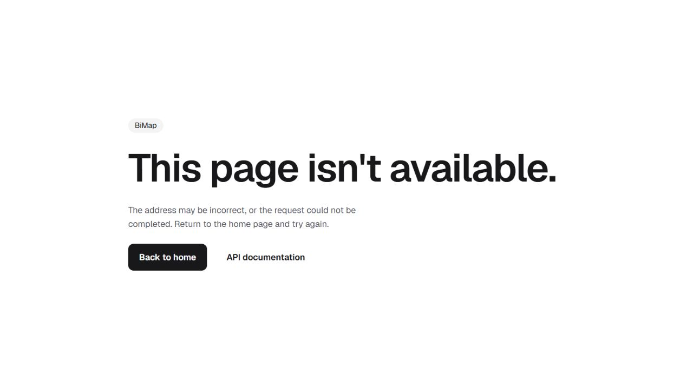

# BiMap Backend

REST API for registering Italian heritage assets on a map: sign-in with JWT, user management for administrators, an Italian comuni autocomplete, asset data and form submissions with CSV export.

---

## Run with Docker

The [root `compose.yaml`](../compose.yaml) runs this backend and the frontend together; see the [root README](../README.md#with-docker). There the backend has no published port: it's reachable only through the frontend's nginx, so every path in this README gets an `/api` prefix. For example, Swagger UI is at <http://localhost:8080/api/swagger-ui.html> and the health check at <http://localhost:8080/api/actuator/health>. The database file lives in the `bimap-data` volume at `/data/bimap.db`.

## Run locally

Requires JDK 27.

```bash
cp .env.example .env
./mvnw spring-boot:run
```

The app reads `.env` from the working directory, so run it from this folder. In IntelliJ, use the shared **BiMap** run configuration in [`.run/`](.run/BiMap.run.xml). It adds `--enable-native-access=ALL-UNNAMED`, which the SQLite driver's native library needs on Java 24 and later; `spring-boot:run`, the tests and the jar's manifest already set it. It creates `bimap.db` in the same folder on first start and applies the [Flyway migrations](src/main/resources/db/migration). Then open:

| URL | What |
|---|---|
| <http://localhost:8080> | Landing page with links |
| <http://localhost:8080/swagger-ui.html> | Interactive API documentation |
| <http://localhost:8080/actuator/health> | Health check |

With `spring.profiles.active=dev` in `.env`, demo users are created on startup; their password is `12345678` (for example `giulia.rossi@bimap.com`, administrator).

## Tests

```bash
./mvnw verify
```

Compiles with `-Werror`, runs PMD and the test suite. The tests start the whole application against a fresh SQLite file under `target/`, run every Flyway migration and mock the mail server, so they need no network, SMTP server or Docker.

| Test class | Covers |
|---|---|
| `AuthApiTest` | Sign-in and sign-up contract, validation, email case, BCrypt's 72-byte limit |
| `SecurityApiTest` | Roles, forged, expired, unsigned and claim-escalated tokens, revoked accounts, email reassignment, invalid subjects, headers, CORS, shared login/signup rate limiting, public endpoints |
| `UserApiTest` | User management contract, conflicts, validation, welcome email escaping and SMTP failures |
| `AssetApiTest` | Assets, places search, form validation, CSV export and formula neutralisation |
| `PersistenceTest` | Migrations, SQLite pragmas, case-insensitive unique emails, database constraints |
| `LoginAttemptsTest` | Concurrent reservations, successful sign-in releases, storage capacity, window expiry and late completions |
| `AccountLifecycleTest` | Last-administrator protection, password/stale-token revocation, reactivation and optional role updates |
| `ConcurrentAccountTest` | Real concurrent sign-ups and administrator deletions, outside a shared test transaction |
| `UserServiceTest` | Authentication keeps the verified account identity when an email changes |
| `AdminBootstrapTest` | First administrator, restart safety, invalid configuration and refusal to promote existing public accounts |
| `CsvExportTest` | Multiple batches, UTF-8, complete columns, empty exports and formula prefixes |
| `MigrationBackupTest` | Upgrade from V2 with existing users/forms, consistent SQLite backup and integrity check |

## Configuration

All secrets come from the environment. Locally they live in `.env` (git-ignored); in production, set them as real environment variables.

| Variable | Required | Description |
|---|---|---|
| `JWT_SECRET` | yes | HS256 signing key, at least 32 bytes; the app refuses to start with a shorter one |
| `MAIL_HOST`, `MAIL_PORT` | yes | SMTP server |
| `MAIL_USERNAME`, `MAIL_PASSWORD` | yes | SMTP credentials |
| `MAIL_FROM` | yes | Sender address of outgoing emails |
| `DB_PATH` | no | SQLite file, default `bimap.db` in the working directory |
| `APP_FRONTEND_URL` | no | Allowed CORS origin and link in emails, default `http://localhost:4200` |
| `CONTENT_SECURITY_POLICY` | no | Overrides the default `Content-Security-Policy` header |
| `API_DOCS_ENABLED` | no | `false` turns off Swagger UI and `/v3/api-docs`, default `true` |
| `SERVER_FORWARD_HEADERS_STRATEGY` | no | `framework` behind a trusted reverse proxy (Compose sets it); leave unset when the app is exposed directly |
| `SERVER_PORT` | no | HTTP port, default `8080` |
| `spring.profiles.active` | no | `dev` seeds demo users; leave unset in production |
| `BOOTSTRAP_ADMIN_EMAIL`, `BOOTSTRAP_ADMIN_PASSWORD` | bootstrap only | First administrator credentials, used only with the `bootstrap-admin` profile |

Generate a strong JWT secret with `openssl rand -base64 48`.

### First production administrator

Set `BOOTSTRAP_ADMIN_EMAIL` and `BOOTSTRAP_ADMIN_PASSWORD` through the environment, then start once with `SPRING_PROFILES_ACTIVE=bootstrap-admin`. Keep `dev` off. The password must satisfy the same character and UTF-8 byte limits as API passwords. After provisioning, remove the bootstrap profile and credentials and restart normally.

The bootstrap creates an administrator only when no active, unlocked administrator exists. It does not overwrite an existing administrator or promote an existing ordinary account with the supplied email; an email conflict stops startup. Invalid bootstrap configuration also stops startup without logging the password. There is no public bootstrap endpoint.

## API

Every endpoint except sign-in, sign-up and the public pages needs the header `Authorization: Bearer <token>`. Controller errors follow RFC 9457 (`application/problem+json`); validation errors add an `errors` map of field to message. Authentication and authorization failures use Spring Security's standard `401`/`403` responses.

| Method and path | Access | Description |
|---|---|---|
| `POST /auth/login` | public | `{ email, password }` → `{ token, user }`, token valid for 10 hours; `429` after 10 failed attempts from one address in 15 minutes |
| `POST /auth/signup` | public | `{ name, surname, email, password }` → `201` with `{ token, user }`; creates a `USER` account (`409` if the email exists); counts towards the same limit |
| `GET /places/regions?q=` | signed in | Regions containing `q` (max 4, `q` up to 100 characters) |
| `GET /places/provinces?q=` | signed in | Provinces containing `q` (max 4) |
| `GET /places/municipalities?q=` | signed in | Comuni containing `q` (max 4) |
| `GET /assets` | signed in | All registered assets |
| `POST /forms` | signed in | Save a form; requires explicit integer `number` and `goodID`; `goodID` is an existing register ID or `0` for an unlisted asset |
| `GET /forms/export.csv` | signed in | All saved forms as a UTF-8 CSV download, written in batches of 500; includes `number` and `goodID` |
| `GET /users` | administrator | List users |
| `GET /users/exists?email=` | administrator | Whether an email is already registered |
| `POST /users` | administrator | Create a user (`201`, `409` if the email exists) |
| `PUT /users/{id}` | administrator | Update a user; password, role and `enabled` change only if sent; `409` if this would disable or demote the last active administrator |
| `DELETE /users/{id}` | administrator | Delete a user (`204`); `409` for the last active administrator |
| `POST /users/{id}/welcome-email` | administrator | Email the user a link to sign in (`503` if the mail server fails) |

Emails are compared without regard to case. New passwords require at least 8 characters and at most 72 UTF-8 bytes, the limit of BCrypt. Multibyte characters use more than one byte; 36 `é` characters fit, while 37 do not. Sign-in also rejects passwords over 72 UTF-8 bytes. Invalid passwords return `400` with an `errors.password` entry. The full contract, with request and response schemas, is in Swagger UI.

## Monitoring

| Endpoint | Shows |
|---|---|
| `/actuator/health` | `UP` / `DOWN`; administrators also see database and disk details |
| `/actuator/health/liveness`, `/actuator/health/readiness` | Probes for Docker and Kubernetes |
| `/actuator/info` | Name, version and description |

No other actuator endpoints are exposed over HTTP. The mail server is not part of health: the app works without it, and a failed email returns `503` on that request only. Logs go to the console and never contain passwords, tokens or email addresses.

## Security

- Passwords are stored as BCrypt hashes and never returned by the API.
- Stateless JWT authentication with Spring Security. Tokens carry the immutable user ID, a token version and an expiry. Account status, version and role are checked against the database on every request. Password changes and enabled-state changes increment the version; re-enabling an account does not revive old tokens. Reassigning an email cannot transfer a token to another account. Earlier tokens without an ID subject and version are rejected; users must sign in again after upgrading.
- Authentication and loading the verified account by ID happen in one transaction. The last active administrator cannot be deleted, disabled or demoted, including by concurrent requests in the supported single-instance configuration.
- Failed sign-ins and sign-ups share a limit of 10 per client address in 15 minutes. Slots are reserved atomically before authentication, so in-flight requests count; successful sign-ins release their own slot. Storage is capped at 10,000 client windows. At capacity, new clients receive `429` with `Retry-After` until space expires, while existing limits stay intact.
- Every request body, query parameter and path variable is validated; requests never bind JPA entities.
- CSV text cells, including imported ISTAT codes, that start with `=`, `+`, `-`, `@`, tab, carriage return or line feed are prefixed with `'` to neutralise formulas.
- Responses carry a restrictive `Content-Security-Policy`, `X-Frame-Options: DENY`, `X-Content-Type-Options: nosniff` and `Referrer-Policy: no-referrer`. The landing page and Swagger UI work under it with no inline code.
- CSRF protection is off on purpose: the API authenticates only through the `Authorization` header, never with cookies.
- CORS allows only the configured frontend origin.
- Public pages show no Java, Spring Boot or OS versions.
- The Docker image runs as a non-root user and contains only the JRE and the jar.
- SMTP requires STARTTLS and verifies the server identity. A mail server without STARTTLS cannot receive credentials or messages from this configuration.
- Compose's nginx discards incoming `Forwarded`, `X-Forwarded-Port` and `X-Forwarded-Ssl` headers and sets trusted forwarding headers itself. Keep the backend private when forwarding-header support is enabled.

## Database

SQLite in a single file, with WAL journaling, foreign keys on, a 5-second busy timeout and a one-connection pool, so all database work runs one transaction at a time. [Flyway](src/main/resources/db/migration) owns the schema; Hibernate never changes it (`ddl-auto=none`). `V1` creates the tables, `V2` loads the asset register and comuni list, `V3` adds token revocation versions, and `V4` repairs known reference-text encoding errors while preserving locally changed values. Future changes get a new migration; applied migrations stay unchanged.

### Limits

- **One writer at a time.** Fine for this app's load; heavy concurrent writing would queue behind the single connection.
- **One instance only.** The file can't be shared by several app instances or over a network file system. Scaling out means moving to a server database.
- **Backups must be consistent.** Copying the file while the app runs can capture a half-written state. Use `sqlite3 bimap.db ".backup 'bimap-backup.db'"` or stop the app first.
- Case-insensitive matching (emails, place search) covers ASCII letters only; MySQL's collation also ignored accents.
- The legacy comuni list covers only part of Italy. Region/province/municipality fields remain free text on the backend; the frontend uses Comuni-ITA for current geographic selections. The backend does not claim to validate geographic consistency or ISTAT ownership against this incomplete dataset.

### CSV exports

The column order is `id,region,province,municipality,address,name,istatCode,latitude,longitude,number,goodID`. The last two columns are appended to the original format. An empty export still contains the header. The export captures the maximum form ID at its start and reads bounded pages, so later submissions are left for the next export. It streams synchronously without holding a database connection while writing to the client. Spreadsheet applications may infer numeric types and remove leading zeroes from ISTAT codes; import that column as text.

### Moving data from MySQL

The asset register and comuni come from the migrations, so only `users` and `form` need to be copied. Nothing here deletes the MySQL data.

1. **Back up MySQL:** `mysqldump -u root -p bimap > bimap-mysql-backup.sql`
2. **Create the SQLite schema:** start the new version once (`./mvnw spring-boot:run`), then stop it.
3. **Export the two tables as tab-separated files:**

   ```bash
   mysql -u root -p -B -N bimap -e "SELECT id, name, surname, email, password, role, locked, enabled, UNIX_TIMESTAMP(created_at)*1000, UNIX_TIMESTAMP(updated_at)*1000, 0 FROM users" > users.tsv
   mysql -u root -p -B -N bimap -e "SELECT id, region, province, municipality, address, good_naming, number, goodid, istat_code, latitude, longitude FROM form" > form.tsv
   ```

4. **Import them:**

   ```bash
   sqlite3 bimap.db <<'SQL'
   .mode tabs
   .import users.tsv users
   .import form.tsv form
   UPDATE form SET istat_code = NULL WHERE istat_code = 'NULL';
   SQL
   ```

5. **Check:** compare `SELECT count(*)` on both sides, sign in with a known account and download the CSV export.

**Rollback:** stop the new version and start the previous release against the untouched MySQL database. If anything was written to SQLite in the meantime, export it the same way in reverse. Keep `bimap-mysql-backup.sql` until the new version has run in production for a while.

## Project structure

```
src/main/java/com/bimap
├── controller   REST endpoints and error handling
├── core         Security, rate limiting, mail, OpenAPI and dev seed data
├── model        JPA entities and response records
├── repository   Spring Data repositories and JdbcClient queries
└── service      User management
src/main/resources
├── db/migration Flyway migrations
├── static       Landing page, favicon, self-hosted Geist font and image
└── application.properties
```

## Before going to production

- Rotate every secret that was ever committed and set new ones as environment variables.
- Leave `dev` off. Provision the first administrator with the one-time `bootstrap-admin` profile, then remove that profile and its credentials.
- Serve the app over HTTPS behind a reverse proxy, so the browser also gets `Strict-Transport-Security`.
- Decide whether Swagger UI stays public (`API_DOCS_ENABLED=false` turns it off).
- Schedule backups of the database volume with `sqlite3 .backup`.

## Author

**Khova Krishna Pilato** — [github.com/krishnapilato](https://github.com/krishnapilato)

## Browser pages

The landing shares the live Wikimedia Commons gallery with the frontend, including bounded loading, thumbnail preloading and source/license credits. Keep `static/landmarks/gallery.js` and `gallery.css` synchronized with `frontend/public/landmarks/`.

Browser requests accepting HTML receive the generic error page for errors, invalid URLs, authentication failures and forbidden access; the HTTP status and authentication challenge are preserved. API clients retain JSON error contracts. Error links respect the reverse-proxy context prefix. `mvnw verify` currently runs 75 tests plus compilation and PMD checks.



