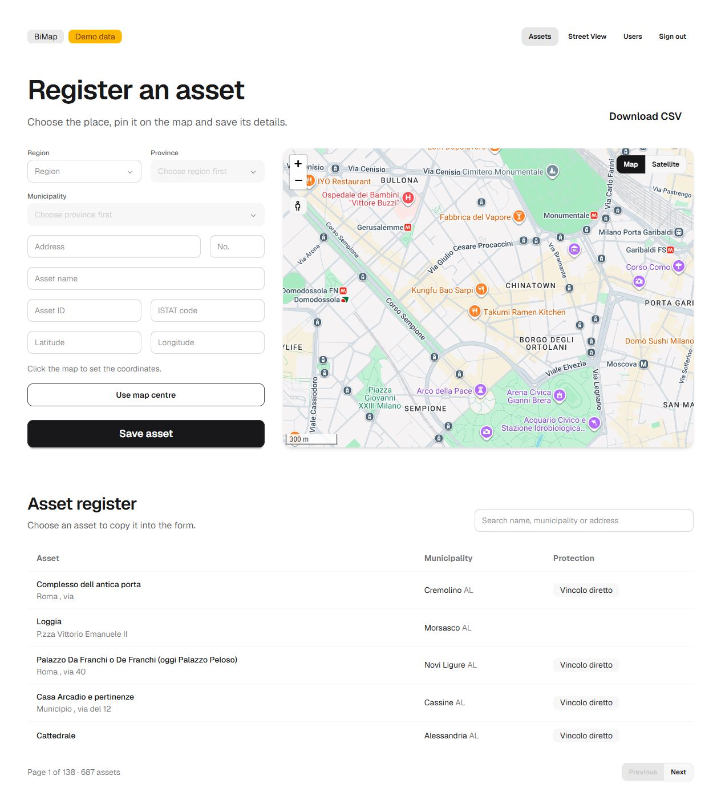

# BiMap Frontend

Angular client for registering Italian heritage assets on a map, managing users and exploring places in Street View.

**Live demo:** [krishnapilato.github.io/bimap](https://krishnapilato.github.io/bimap/)



## Pages

| Route | Page | Access |
|---|---|---|
| `/` | Landing page with a live Italian heritage photograph | public |
| `/login` | Sign in and sign up | public |
| `/assets` | Register an asset: place, address, map pin, and the asset register | signed in |
| `/street-view` | Road map with Street View coverage and a live panorama | signed in |
| `/users` | User management: create, edit, enable or disable, delete, welcome email | administrator |

## Running

```bash
npm install
npm start
```

Open <http://localhost:4200>. The app expects the [backend](../backend/README.md) on `http://localhost:8080`.

### Demo mode

```bash
npm run start:demo
```

The demo build needs no backend and starts signed in as an administrator. Guards still enforce authentication and roles. All 687 real reference assets are loaded lazily on opening the register and cached in sessionStorage; corrupt or unavailable storage falls back to the bundled catalog. User edits and saved forms remain in memory and reset on reload. Comuni-ITA, Nominatim, Wikimedia Commons and Google Maps are called for real.

## Building

| Command | Output |
|---|---|
| `npm run build` | Production build against the real backend |
| `npm run build:demo` | Demo build for GitHub Pages, served from `/bimap/` |

Both write to `dist/frontend/browser`.

## How it is built

- **Standalone components, signals and zoneless change detection** throughout.
- **Signal Forms** (`@angular/forms/signals`) for every form, with validation in the schema.
- **`rxResource`** for loading data, including the region → province → municipality chain.
- **Tailwind CSS and daisyUI** for all styling, with no component stylesheets. The theme lives in `src/tailwind.css`.
- **Functional guards and interceptors**; the JWT is kept in a signal-based `AuthService`.
- **Angular style guide naming**: feature folders and component files without a `.component` suffix.
- **No UI library besides daisyUI**: notifications go through a small `ToastService`.

## External services

| Service | Used for |
|---|---|
| [Comuni-ITA](https://github.com/Samurai016/Comuni-ITA) | Regions, provinces, municipalities and ISTAT codes |
| [Nominatim](https://nominatim.org/) | Turning an address into coordinates |
| Google Maps JavaScript API | Map tiles and Street View |

### Google Maps key

Street View needs a Google Maps JavaScript API key. It isn't in the source: the build inserts it as `GOOGLE_MAPS_KEY` through Angular's `define` option, and without one Street View doesn't load.

| Where | How |
|---|---|
| Local | `npx ng serve --define 'GOOGLE_MAPS_KEY="<your key>"'` |
| GitHub Pages demo | The `GOOGLE_MAPS_KEY` repository secret, read by [`pages.yml`](../.github/workflows/pages.yml) |
| Docker | `GOOGLE_MAPS_KEY` in your shell or the root `.env` before `docker compose up --build` |

A browser key always ends up in the built JavaScript, so restrict it in Google Cloud to the sites that use it (HTTP referrers) and to the Maps JavaScript API.

## Project structure

```
src/app
├── core                 App-wide plumbing
│   ├── auth             AuthService, guards, interceptor and auth models
│   └── demo             Mock data and the interceptor used by the demo build
├── shared               Autocomplete, dialogs, gallery, CSV preview, navbar and toasts
└── features             One folder per page
    ├── home             Landing page
    ├── login            Sign in, sign up and sign out
    ├── assets           Asset registration, its service and models
    ├── street-view      Street View page
    └── users            User management, its service and models
```

## Reliability and UI

Run `npm run lint` and `npm test -- --watch=false`. The suite covers sessions, late authentication responses, asynchronous place selection, autocomplete keyboard navigation, user actions, demo storage, photographs and CSV parsing/saving. TypeScript targets ESNext with explicit ES2023 and DOM libraries; it remains pinned to the Angular-compatible 6.0 release.

State uses Angular signals and rxResource, with dedicated auth and demo services. Sessions validate expiry, synchronize across tabs and retain an in-memory fallback when storage is blocked. Native dialogs handle focus and background interaction. Place autocomplete supports keyboard selection.

CSV export opens a bounded preview of the first ten records. Save CSV opens the native location picker where supported; other browsers use their configured download behavior. The table scrolls inside the dialog.

## Live heritage photographs

Home and login use the same gallery as the backend landing. The configured Wikimedia Commons API discovers freely licensed Italian Wiki Loves Monuments photographs, without a city list, photo URLs or an API key. One photograph is selected per page load. Titles are cleaned and credits link to the source and license.

The gallery requests 960-pixel thumbnails, keeps a five-photo metadata queue in sessionStorage for six hours, preloads queued images into the browser HTTP cache and replenishes near exhaustion. Image bytes are never written to sessionStorage. Initial retrieval still depends on Commons; requests and image loads time out after ten seconds and offer Retry on failure. The narrowly scoped CSP allows Commons API and image hosts while retaining autoCsp and Google Maps style support.
